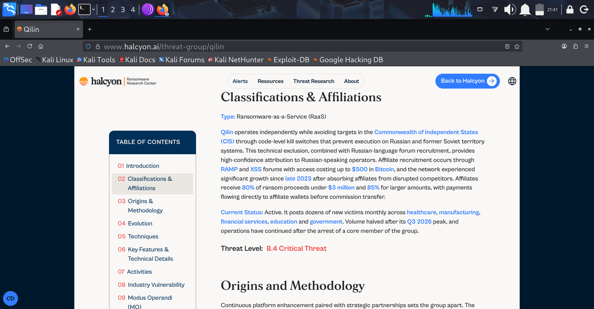
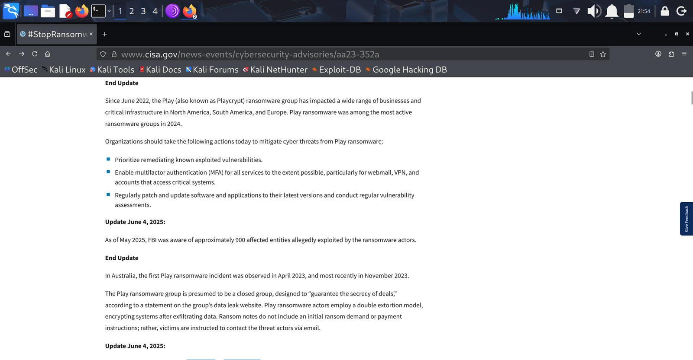

# Evidence - Underground Threat Economy

## Public Excerpt 1: Qilin Affiliate Model

| Field | Detail |
|---|---|
| Source | [Halcyon Qilin threat-group profile](https://www.halcyon.ai/threat-group/qilin) |
| Collected | 18 Nov 2026 |
| Supports | Qilin classification as RaaS and the reported 80/85 percent affiliate share |
| Does not prove | That every affiliate receives those terms or that the profile independently observed private contracts |
| Private evidence ID | A1-09 |

## Public Excerpt 2: Play Closed-Group Reporting

| Field | Detail |
|---|---|
| Source | [CISA/FBI/ASD Play advisory](https://www.cisa.gov/news-events/cybersecurity-advisories/aa23-352a) |
| Source revision | 4 Jun 2025 |
| Collected | 18 Nov 2026 |
| Supports | CISA's statement that Play is presumed to be a closed group |
| Does not prove | That Play never uses external brokers or partners |
| Private evidence ID | A1-13 |

## Wider Private Evidence

The private pack also contains evidence for all five marketplace categories, three ransomware groups, initial-access pricing, and forum-culture research. Relevant integrity IDs are A1-01 through A1-05, A1-09, A1-12, A1-13, and A1-14 in the manifest.
