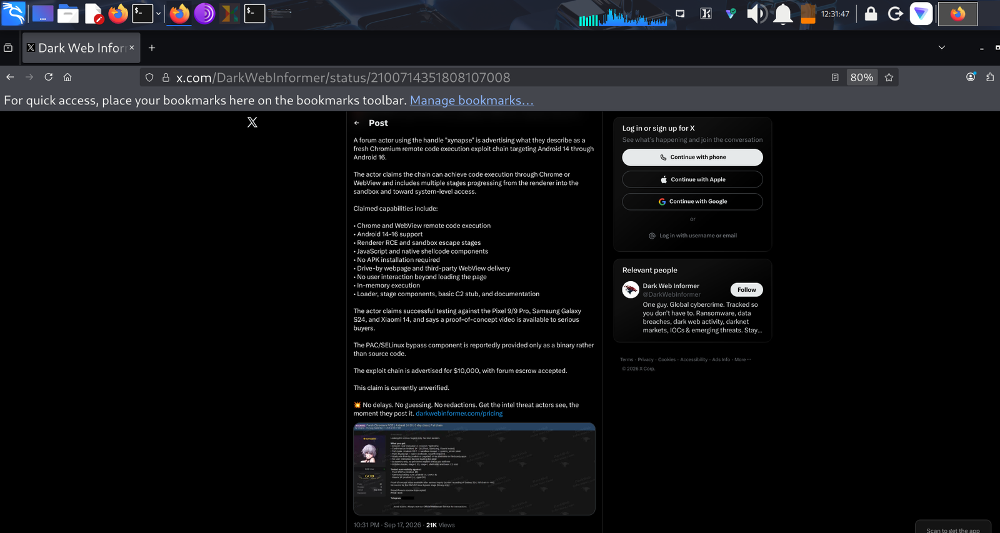
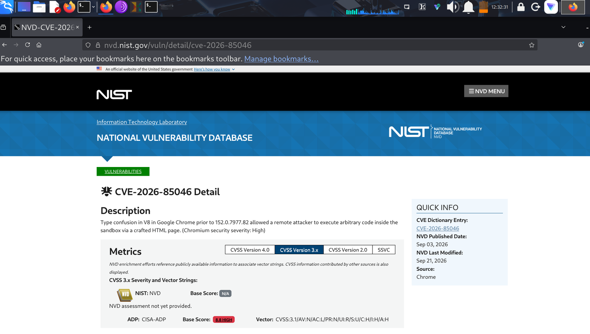
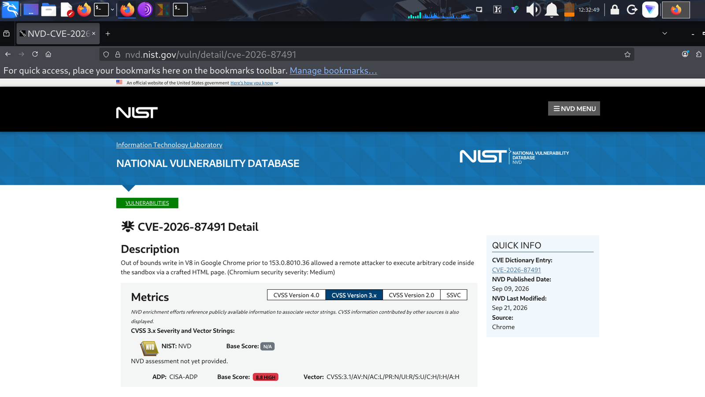

# Evidence - Exploit-Claim Credibility

## Public Excerpt 1: Reproduced Advertisement

| Field | Detail |
|---|---|
| Source | Public Dark Web Informer post on X |
| Source date | 17 Sep 2026 |
| Supports | The advertised Android scope, renderer/escape language, USD 10,000 price, and acceptance of forum escrow |
| Does not prove | Original forum provenance, seller identity, exploit functionality, or a completed sale |
| Private evidence ID | A2-01 |

## Public Excerpt 2: CVE-2026-85046

| Field | Detail |
|---|---|
| Source | [NVD CVE-2026-85046](https://nvd.nist.gov/vuln/detail/CVE-2026-85046) |
| Published | 3 Sep 2026 |
| Supports | A public V8 renderer-RCE analogue existed before the advertisement |
| Does not prove | That the seller possessed or repackaged this CVE |
| Private evidence ID | A2-03 |

## Public Excerpt 3: CVE-2026-87491

| Field | Detail |
|---|---|
| Source | [NVD CVE-2026-87491](https://nvd.nist.gov/vuln/detail/CVE-2026-87491) |
| Published | 9 Sep 2026 |
| Supports | A second public V8 renderer-RCE analogue existed before the advertisement |
| Does not prove | Seller linkage or the advertised sandbox-escape and system-level stages |
| Private evidence ID | A2-04 |

## Wider Private Evidence

Eight original captures preserve the advertisement, secondary article, NVD records, contemporary exploitation reporting, and CISA KEV context. Their integrity IDs are A2-01 through A2-08.
