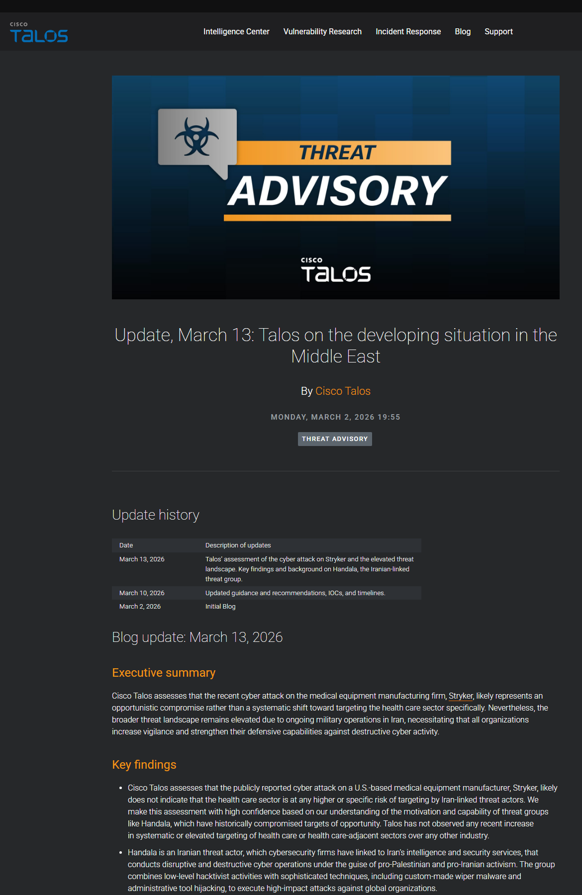

# Evidence - Handala Threat Actor

## Public Excerpt: Talos Threat Advisory

| Field | Detail |
|---|---|
| Source | [Cisco Talos developing-situation advisory](https://blog.talosintelligence.com/talos-developing-situation-in-the-middle-east/) |
| Published / updated | 2 Mar / 13 Mar 2026 |
| Supports | Talos reporting on Handala, the Stryker disruption, and Iran-linked destructive activity |
| Does not prove | Every actor claim, the reported scale of destruction, or direct MOIS control |

## Attribution Source Lineage

| Source | Contribution | Independence limit |
|---|---|---|
| Check Point Research | Void Manticore mapping, persona lineage, tooling, access handoff | Primary public technical-attribution lineage for several repeated claims |
| Cisco Talos | Stryker disruption context and broader Iran-linked assessment | Repeats industry attribution for the persona-to-MOIS relationship |
| SOCRadar and other vendors | Additional incidents, aliases and observables | Individual claims require independent victim or technical confirmation |

The private research-log integrity ID is A3-R1. It records confidence changes, rejected mappings, source-lineage concerns, and unresolved gaps.
