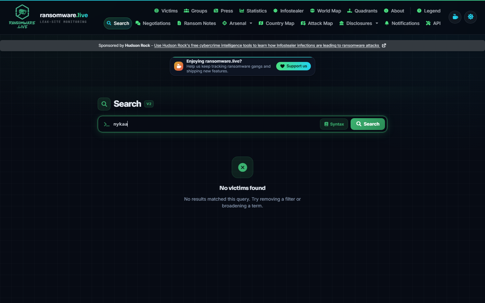

# Evidence - Brand Exposure Monitoring

## Public Excerpt: Leak-Site Tracker Search

| Field | Detail |
|---|---|
| Source | [Ransomware.live public search](https://www.ransomware.live/search) |
| Collected | 18 Nov 2026, source data updated 15:50 UTC |
| Query | `nykaa` |
| Supports | No matching victim appeared in this tracker at the collection time |
| Does not prove | That no breach, private-forum mention, stealer record, or unindexed actor claim exists |
| Private evidence ID | A4-03 |

## Registration And DNS Evidence

| Check | Public source / method | Finding |
|---|---|---|
| Registrant confirmation | [RDAP for nykaa.in](https://rdap.org/domain/nykaa.in) and [nykaa.co.in](https://rdap.org/domain/nykaa.co.in) | FSN E-Commerce appeared as registrant for both domains |
| Nested-domain correction | [RDAP for com.xyz](https://rdap.org/domain/com.xyz) | `nykaa.com.xyz` was a subdomain, not a separate Nykaa registration |
| Dynamic infrastructure | `tools/passive_dns_snapshot.py` | DNS and PTR were treated as timestamped metadata, not ownership or intent proof |

The private evidence manifest records seven RDAP/tracker captures plus timestamped DNS and public-search snapshots under A4-01 through A4-07, A4-DNS, and A4-SEARCH.
